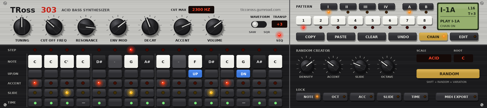

# TRoss 303

TB-303 style bass synth for Max for Live: a circuit-modelled sound engine with a 303-style
sequencer, 64-pattern memory, pattern chaining and a random pattern creator.

By **Ticco Ross** · [ticcoross.gumroad.com](https://ticcoross.gumroad.com/) · ticcoross@gmail.com



## Download

Get the latest zip from [Releases](../../releases/latest). It contains the device, the engine for
macOS (`tross303~.mxo`, Apple Silicon + Intel) and Windows (`tross303~.mxe64`), and the
[user manual](docs/TRoss303_Manual.pdf).

1. Unzip and drag the **TRoss 303** folder into Live's User Library (keep the files together).
2. macOS only, once: `xattr -dr com.apple.quarantine "<path to the TRoss 303 folder>"`
3. Drop **TRoss 303.amxd** on a MIDI track.

## Features

- **Sound**: the [Lemus](https://github.com/lemus-dev/lemus) ro-mono-303 voice, used unchanged: a
  part-by-part model of the TB-303 main board from the CPU latches on (pitch DAC and slide, VCO,
  4-pole ladder, MEG/VEG, accent sweep, VCA, output stage), oversampled.
- **Controls**: Tuning, Cut Off, Resonance, Env Mod, Decay, Accent, Volume, Saw/Square, Cut Max,
  Transpose. All Live parameters (automation, mapping, saved with the set).
- **Sequencer**: 16 steps with note, octave up/down, accent, slide and note/tie/rest, 1–16 step
  length, synced to Live's transport.
- **Pattern memory** like the 303: 4 groups × 8 patterns × A/B = 64 patterns, saved in the Live set.
  Copy, paste, clear, undo. Selections switch at the pattern end.
- **Chain**: up to 16 patterns played in order.
- **Random pattern creator**: scale and root, density, accent, slide and octave amounts, and locks
  per lane (re-roll only the rhythm, only the accents…).
- **MIDI**: notes play the voice too (velocity ≥ 100 = accent, overlapping notes slide).

## Building

Needs CMake 3.25+ and a C++17 compiler (Xcode on macOS, Visual Studio 2022 or newer on Windows).

```sh
git clone --recursive https://github.com/Spunkmeyer77/TRoss303.git
cd TRoss303
cmake -S . -B build -DCMAKE_BUILD_TYPE=Release
cmake --build build --config Release        # -> externals/tross303~.mxo / .mxe64
python3 tools/make_device.py                # -> device/TRoss 303.amxd
```

Engine tests (any platform, renders WAVs to listen to):

```sh
cmake -S . -B build-tests -DTROSS_TESTS=ON && cmake --build build-tests
./build-tests/engine_test .
```

GitHub Actions builds both externals, assembles the device folder and the manual on every push,
and publishes a release for every `v*` tag.

### Layout

| Path | What |
|---|---|
| `engine/` | Sequencer, pattern bank, random creator and the voice wrapper (plain C++) |
| `source/tross303~/` | The Max external (Max SDK C API) |
| `device/` | The panel script (`tross303_panel.js`) and the generated `.amxd` |
| `tools/` | Device and manual generators, panel preview |
| `third_party/lemus` | Lemus v0.1.3 (submodule) — the TB-303 voice |
| `third_party/max-sdk-base` | Cycling '74 Max SDK base (submodule) |

### Messages understood by `tross303~`

Knobs (0–10): `tuning cutoff resonance envmod decay accent volume`; `wave 0|1`, `cutmax <Hz>`,
`transpose <st>`, `seq 0|1`. MIDI: `note <pitch> <vel>`, `flush`. Patterns: `select <0-63>`,
`setstep <i> note|oct|acc|slide|time <v>`, `length <n>`, `random`, `undo`, `copy`, `paste`,
`clear`, `chain 0|1`, `chainadd <idx>`, `chainclear`. Random settings: `rscale`, `rroot`,
`rdensity rslide raccent rspread` (0–100), `rlock <lane> 0|1`. State: `bank ...`, `refresh`.

## License

TRoss 303 is free software under the **GNU Affero General Public License v3** (see
[LICENSE](LICENSE)), as is Lemus, whose TB-303 voice it uses. If you distribute the device (or a
modified one), you must also make its source available under the same license.

TB-303 is a trademark of Roland Corporation. This project is not affiliated with or endorsed by
Roland.
